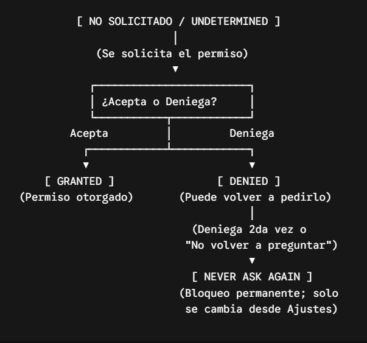
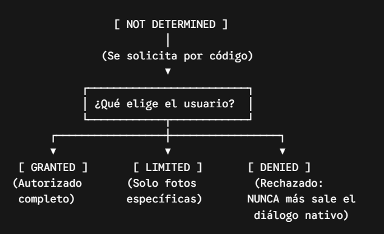

# Parte A · ¿Qué es un permiso y por qué existe?

## A1. Conceptos 

a) ¿Qué es un permiso? ¿Qué papel cumplen la app, el sistema operativo y la persona
usuaria?

Respuesta: Un permiso es una autorización especial que limita a qué funciones del dispositivo (como la cámara o el GPS) o a qué datos privados (como contactos o fotos) puede acceder una aplicación para proteger la seguridad y privacidad del equipo.

*La app: Es la solicitante. Define qué funciones necesita para operar y le pide formalmente acceso al sistema operativo (por ejemplo, WhatsApp pidiendo usar el micrófono para mandar un audio).
*El sistema operativo (Android, iOS, etc.): No deja que ninguna app acceda al hardware por su cuenta; intercepta el pedido, le muestra el aviso a la persona usuaria y bloquea o habilita el acceso según lo que se decida.
*La persona usuaria: Es la autoridad final. Decide si concede, limita (por ejemplo, "solo mientras la app está en uso") o deniega el permiso, pudiendo cambiar de opinión y revocarlo en cualquier momento desde los ajustes.

b) ¿Qué es la caja de arena (sandbox) y qué relación tiene con los permisos? ¿Qué puede
hacer una app sin ningún permiso?

Respuesta: La caja de arena (sandbox) es un mecanismo de seguridad del sistema operativo que aísla a cada aplicación en su propio espacio cerrado. Ninguna app puede espiar, modificar ni acceder directamente a la memoria o a los archivos privados de otra.
    *La caja de arena es el límite base: Encierra a la app por defecto para que no tenga acceso libre al resto del dispositivo.
    *Los permisos son las "puertas": Permiten abrir brechas controladas en esa caja. Cuando una app necesita salir de su aislamiento para interactuar con el entorno (usar el micrófono, leer fotos o ver la ubicación), debe pedir un permiso explícito. Sin permiso, la app queda estrictamente confinada dentro de su caja.

Una app sin permisos solo puede operar dentro de su espacio privado asignado:
    *Ejecutar su lógica interna: Procesar cálculos, animaciones, reglas de negocio o mecánicas de juego (por ejemplo, un juego offline o una calculadora).
    *Gestionar su interfaz: Mostrar botones, menús, gráficos y responder a los toques en la pantalla.
    *Guardar datos propios: Crear y leer archivos, bases de datos o configuraciones en su carpeta privada (a la que nadie más tiene acceso).
    *Usar sensores básicos no invasivos: Leer datos comunes que no revelan privacidad directa, como el acelerómetro o giroscopio (salvo regulaciones específicas en versiones muy recientes para evitar rastreo indirecto).

c) Nombrá las cuatro razones por las que existen los permisos y dá un ejemplo concreto de
cada una.

Las cuatro razones principales por las que existen los permisos son:

Privacidad de datos personales: Evita que las apps lean información íntima sin consentimiento.
Ejemplo: Impedir que un juego lea tu lista de contactos o tus mensajes SMS.

Control de costos e impacto económico: Previene acciones que generen gastos directos en la factura telefónica.
Ejemplo: Bloquear que una app envíe mensajes SMS premium o realice llamadas de pago de forma oculta.

Protección de hardware e integridad del dispositivo: Controla el uso de componentes físicos para evitar espionaje, desgaste o consumo excesivo de batería.
Ejemplo: Exigir confirmación antes de encender el micrófono, la cámara o el sensor de GPS.

Seguridad del sistema y límites entre apps: Impide que una aplicación interfiera con otras o modifique configuraciones críticas del sistema operativo.
Ejemplo: No permitir que una app recién instalada acceda a la memoria privada del navegador para robar contraseñas o tokens bancarios.

d) En la analogía del portero del edificio, ¿quién es la visita, quién el portero y quién el dueño
del departamento? ¿Qué significa que “el portero se acuerda de la respuesta”?

En la analogía del portero del edificio, los roles se distribuyen de la siguiente manera:
La visita: Es la aplicación, que llega desde afuera e intenta entrar a un área específica o acceder a ciertos recursos.
El portero: Es el sistema operativo, que vigila la entrada, frena a la visita antes de que pase y consulta si está autorizada.
El dueño del departamento: Es la persona usuaria, quien tiene la última palabra para decidir si deja pasar o no a la visita.

Significa que el sistema operativo guarda la decisión del usuario en memoria para futuras ocasiones.
Una vez que elegís "Permitir siempre" o "No volver a preguntar", el sistema registra esa regla:
Las próximas veces que la app intente usar esa función, el sistema no volverá a molestarte con una ventana de confirmación en pantalla.
Le abrirá o cerrará el paso de forma automática e inmediata, hasta que decidas cambiar esa regla manualmente desde los ajustes del dispositivo.

## A2. Declarar y solicitar

| | Declarar (al compilar) | Solicitar (al ejecutar) |
| :--- | :--- | :--- |
| **¿Qué se hace?** | Se avisa al sistema operativo (en la configuración) qué permisos podría llegar a necesitar la app. | Se le muestra un cuadro de diálogo a la persona usuaria pidiendo la autorización real mientras usa la app. |
| **¿Dónde / cómo en Android?** | En el archivo `AndroidManifest.xml` usando la etiqueta `<uses-permission>`. | Mediante código (Java/Kotlin) llamando a las APIs del sistema para pedir los permisos en tiempo de ejecución. |
| **¿Dónde / cómo en iOS?** | En el archivo `Info.plist` agregando las claves de justificación (las que terminan en `UsageDescription`). | Mediante código (Swift/Objective-C); el sistema lanza el aviso la primera vez que se intenta usar la función. |
| **¿Dónde / cómo en Expo?** | En el archivo `app.json` agregando los plugins correspondientes o editando las secciones `android.permissions` e `ios.infoPlist`. | Mediante código en React Native, usando los métodos de la librería (por ejemplo, `requestForegroundPermissionsAsync()`). |
| **¿Qué pasa si se omite?** | La app se cierra inesperadamente al intentar usar la función, o la tienda de aplicaciones directamente rechaza subirla. | La función bloqueada no se ejecuta (devuelve error o "denegado") o la aplicación crashea por una excepción de seguridad. |

## A3. Verdadero o falso

a) Falso. El diálogo lo dibuja el sistema operativo de forma nativa e inalterable, no se renderiza con componentes de React Native.

b) V

c) Falso. Las actualizaciones OTA solo envían código JavaScript y recursos; modificar Info.plist requiere compilar un nuevo binario nativo.

d) Falso. Si el permiso no está en el manifiesto, Android ignora la solicitud, no muestra ningún diálogo y la llamada falla directamente.

e) Falso. expo-permissions está deprecado; la forma recomendada es usar los métodos de permisos propios de cada módulo individual (como expo-camera o expo-location).

f) V

g) V

h) V

## A4. Los estados de un permiso

Diagrama de estados en Android
En Android el flujo principal maneja tres estados:

No solicitado / Indeterminado: Estado inicial de instalación.

Granted (Concedido): La persona usuaria autoriza el acceso (siempre o mientras la app esté en uso).

Denied (Denegado común): La persona usuaria dijo que "No" una vez. La app puede volver a consultar en una próxima ocasión (y Android recomienda mostrar una justificación o rationale antes de reintentar).

Never Ask Again (Denegado permanente): Si el usuario rechaza dos veces o marca la casilla para no recibir más avisos, el diálogo nativo se silencia por completo; llamar a la API devuelve denegado automáticamente sin mostrar nada.

Diagrama de estados en iOS
En iOS el modelo es más estricto y maneja cuatro estados formales:

Not Determined: La app nunca solicitó el permiso antes. Es el único momento en el que el sistema operativo permite lanzar el diálogo nativo.

Granted (Authorized): Acceso total concedido a la función o recurso.

Limited: Variante específica (como en la galería de fotos) donde la persona usuaria restringe el acceso únicamente a los elementos seleccionados manualmente.

Denied: El usuario rechazó el permiso una sola vez. A partir de ese momento, el diálogo nativo no vuelve a aparecer nunca más para esa app.

La diferencia central radica en las segundas oportunidades que da el sistema operativo antes del bloqueo definitivo:

Android da segundas oportunidades: Permite volver a lanzar el diálogo de solicitud si el usuario lo rechazó la primera vez, bloqueándose definitivamente solo si el usuario marca "No volver a preguntar" o si rechaza de forma consecutiva.

iOS es de "un solo disparo" (one-shot): El sistema operativo solo muestra el diálogo nativo una única vez en toda la vida de la app. Si la persona usuaria toca "No permitir", el permiso pasa a estado denegado para siempre y la única forma de habilitarlo es redirigir al usuario manualmente a los Ajustes generales del iPhone (Linking.openSettings()).

b) Completá qué devuelve Expo en cada estado:

| Estado | status | canAskAgain | ¿Puede aparecer el diálogo? |
| :--- | :--- | :--- | :--- |
| Sin decidir | `'undetermined'` | `true` | Sí |
| Concedido | `'granted'` | `true` | No (ya está otorgado) |
| Denegado (se puede volver a pedir) | `'denied'` | `true` | Sí |
| Bloqueado | `'denied'` | `false` | No |

# Parte B · Android: tipos de permisos y manifiesto

## B1. Clasificá los permisos

Indicá el tipo (de instalación / de tiempo de ejecución / especial) y cómo los obtiene la app.

| Permiso | Tipo | ¿Cómo se obtiene? |
| :--- | :--- | :--- |
| `INTERNET` | De instalación | Se declara en el manifiesto y el sistema lo concede automáticamente al instalar. |
| `CAMERA` | De tiempo de ejecución | Se declara en el manifiesto y se solicita mediante un diálogo en pantalla al ejecutar la app. |
| `VIBRATE` | De instalación | Se declara en el manifiesto y el sistema lo concede automáticamente al instalar. |
| `SYSTEM_ALERT_WINDOW` | Especial | Se declara en el manifiesto y requiere redirigir a la persona usuaria a la pantalla especial de Ajustes para activarlo manualmente. |
| `POST_NOTIFICATIONS` | De tiempo de ejecución | Se declara en el manifiesto y se solicita mediante un diálogo en pantalla al ejecutar la app (desde Android 13). |
| `ACCESS_NETWORK_STATE` | De instalación | Se declara en el manifiesto y el sistema lo concede automáticamente al instalar. |
| `READ_CONTACTS` | De tiempo de ejecución | Se declara en el manifiesto y se solicita mediante un diálogo en pantalla al ejecutar la app. |
| `SCHEDULE_EXACT_ALARM` | Especial | Se declara en el manifiesto; en versiones modernas puede requerir que la persona usuaria lo habilite manualmente desde los Ajustes del sistema. |
| `RECORD_AUDIO` | De tiempo de ejecución | Se declara en el manifiesto y se solicita mediante un diálogo en pantalla al ejecutar la app. |
| `MANAGE_EXTERNAL_STORAGE` | Especial | Se declara en el manifiesto y exige redirigir a la persona usuaria a una sección dedicada dentro de los Ajustes del sistema ("Acceso a todos los archivos"). |

## B2. Grupos y nombres

a) ¿Qué es un grupo de permisos? Si la app pide ACCESS_FINE_LOCATION y
ACCESS_COARSE_LOCATION juntos, ¿cuántos diálogos ve la persona?

Un grupo de permisos es una agrupación lógica definida por el sistema operativo que reúne permisos individuales relacionados con un mismo recurso sensible o componente de hardware (por ejemplo, el grupo LOCATION, CAMERA o CONTACTS). Su objetivo es que el usuario tome una decisión unificada sobre esa función y no reciba avisos repetitivos.

Si la app pide ACCESS_FINE_LOCATION (ubicación precisa) y ACCESS_COARSE_LOCATION (ubicación aproximada) juntos:

La persona ve un solo diálogo.

En las versiones modernas de Android, ese único aviso le permite elegir directamente en pantalla el nivel de precisión deseado (aproximada o precisa) y otorgar ambos accesos en una sola acción.

b) ¿Qué prefijo lleva el nombre completo de un permiso? Escribí el nombre completo del
permiso de cámara.

El prefijo que lleva el nombre completo de los permisos estándar del sistema es:
android.permission.

El nombre completo del permiso de cámara es:
android.permission.CAMERA

c) ¿Qué son los permisos de firma (signature)? ¿Por qué no se usan en apps comunes?

Un permiso de firma (signature permission) es un nivel de protección en el cual el sistema operativo solo concede el permiso si la aplicación que lo solicita está firmada digitalmente con el mismo certificado criptográfico (clave privada) que la aplicación que lo declaró o que la propia imagen del sistema operativo.

¿Por qué no se usan en apps comunes?
Requieren la misma firma privada: Una app común descargada de una tienda no comparte la clave criptográfica del fabricante del teléfono (Google, Samsung, etc.) ni de otras empresas, por lo que el sistema rechazaría la concesión automáticamente.

Están diseñados para ecosistemas privados: Su objetivo exclusivo es permitir que dos o más aplicaciones desarrolladas por el mismo fabricante o compañía compartan datos confidenciales o funciones privilegiadas entre sí de forma segura, sin pedir intervención ni confirmación al usuario.

## B3. Leé el manifiesto

a) ¿Qué permisos se conceden solos al instalar y cuáles hay que pedir además en tiempo de
ejecución?

Se concede solo al instalar (normal): INTERNET.   Hay que pedirlos en tiempo de ejecución (peligrosos):CAMERA   ACCESS_COARSE_LOCATION   ACCESS_FINE_LOCATION   POST_NOTIFICATIONS   READ_EXTERNAL_STORAGE (en dispositivos con Android 12L o inferior)  

b) ¿Qué significa android:maxSdkVersion="32"? ¿Qué permisos reemplazan a
READ_EXTERNAL_STORAGE desde Android 13?

Indica que ese permiso solo se solicitará y aplicará en dispositivos cuya versión de la API de Android sea menor o igual a 32 (Android 12L o anterior). En dispositivos con Android 13 o superior, el sistema operativo ignora por completo esta declaración.   Reemplazos desde Android 13 (API 33): Se dividió el acceso a medios en tres permisos granulares:READ_MEDIA_IMAGES (fotos e imágenes)READ_MEDIA_VIDEO (videos)READ_MEDIA_AUDIO (archivos de audio y música)

c) ¿Qué hace tools:node="remove"? Escribí el fragmento de app.json que lo genera.

Le indica al Manifest Merger (fusionador de manifiestos) que elimine esa entrada por completo del archivo compilado final, evitando que dependencias o librerías externas agreguen un permiso no deseado (en este caso, micrófono).   Fragmento en app.json: Se configura dentro de la propiedad blockedPermissions:

{
  "expo": {
    "android": {
      "blockedPermissions": [
        "android.permission.RECORD_AUDIO"
      ]
    }
  }
}

d) Necesitás agregar SCHEDULE_EXACT_ALARM, que ninguna librería declara. ¿En qué propiedad de
app.json va?

Se agrega dentro de la propiedad de arreglo expo.android.permissions:

{
  "expo": {
    "android": {
      "permissions": [
        "android.permission.SCHEDULE_EXACT_ALARM"
      ]
    }
  }
}

e) ¿Por qué en Expo no conviene editar este archivo a mano? ¿Funciona blockedPermissions en
Expo Go?

¿Por qué no conviene editarlo a mano?: Porque en Expo la carpeta android/ es un artefacto generado; cada vez que ejecutes npx expo prebuild (o limpies el caché de build), Expo regenerará el archivo basándose en app.json, sobrescribiendo y borrando cualquier cambio manual.

¿Funciona blockedPermissions en Expo Go?: No. Expo Go es un ejecutable binario precompilado que ya incluye todas las librerías nativas y todos los permisos declarados de antemano; las directivas de exclusión como blockedPermissions solo surten efecto en builds propios generados con Prebuild / EAS Build (Development Builds o producción).

## B4. Así pregunta Android

a) ¿Se puede poner texto propio dentro del diálogo de Android? Entonces, ¿dónde tenés que
explicar para qué usás el permiso?

¿Se puede poner texto propio dentro del diálogo de Android?
No. El diseño, los textos y los botones del diálogo son provistos directamente por el sistema operativo y no se pueden modificar.

¿Dónde tenés que explicarlo?
Se debe explicar en la propia interfaz de tu app mediante una pantalla previa, un modal o una tarjeta explicativa (in-app rationale) justo antes de solicitar el permiso al sistema.

b) ¿Qué diferencia hay entre “Mientras la app está en uso” y “Solo esta vez”? ¿Para qué
permisos existe esta última opción?

Diferencia:

"Mientras la app está en uso": El permiso se mantiene concedido indefinidamente cada vez que la app pase al primer plano, hasta que la persona usuaria lo revoque manualmente.
"Solo esta vez": Es un permiso temporal de un único uso. Se revoca automáticamente cuando la app pasa a segundo plano por un tiempo o cuando se cierra su proceso.

¿Para qué permisos existe "Solo esta vez"?
Aplica exclusivamente a los permisos sensibles de tiempo de ejecución: Ubicación, Cámara y Micrófono (grabación de audio).

c) En Android 11+, ¿qué pasa si la persona toca “No permitir” dos veces? ¿Qué valor toma
canAskAgain?

¿Qué pasa?
El sistema interpreta dos rechazos consecutivos como un bloqueo permanente (equivalente al clásico "No volver a preguntar"). A partir de ese momento, el sistema silencia el aviso nativo y no vuelve a mostrar el diálogo.

¿Qué valor toma canAskAgain?
Toma el valor false.

d) La ubicación aproximada tiene una precisión de unos 3 km². Dá un ejemplo de función que
anda bien con ella y otro de una que no.

Función que anda bien:
Una aplicación de clima o pronóstico meteorológico (alcanza con saber en qué ciudad o zona se encuentra para mostrar la temperatura).

Función que no anda bien:
Una aplicación de navegación paso a paso por GPS o de transporte y viajes (necesita precisión de metros para saber en qué esquina o carril exacto estás).

e) Si la persona revoca un permiso desde Ajustes mientras la app está abierta, ¿qué hace
Android con el proceso de la app?

Android mata de inmediato el proceso de la app en segundo plano. Esto garantiza la seguridad del sistema y reinicia el estado de la aplicación, evitando que el código siga accediendo a recursos que ya no tiene autorizados.

## B5. Android, versión por versión

| Cambio | Versión (API) | Qué implica para el código |
| :--- | :--- | :--- |
| Nacen los permisos en tiempo de ejecución | Android 6.0 (API 23) | Ya no alcanza con el manifiesto; el código debe verificar si tiene permiso antes de usar la función y solicitarlo en tiempo de ejecución si no lo tiene. |
| La ubicación en segundo plano pasa a ser un permiso aparte | Android 10 (API 29) | Se debe declarar `ACCESS_BACKGROUND_LOCATION` y pedir primero la ubicación en primer plano; no se pueden solicitar ambas a la vez en un solo diálogo. |
| Dos rechazos equivalen a “no volver a preguntar” | Android 11 (API 30) | Si el usuario rechaza dos veces, el diálogo nativo no vuelve a aparecer (`canAskAgain: false`); el código debe detectar esto y guiar a la persona usuaria a los Ajustes. |
| Ubicación precisa o aproximada | Android 12 (API 31) | Se deben solicitar juntos `ACCESS_FINE_LOCATION` y `ACCESS_COARSE_LOCATION`, y el código debe estar preparado para funcionar si solo le conceden la aproximada. |
| Las notificaciones pasan a ser un permiso (`POST_NOTIFICATIONS`) | Android 13 (API 33) | Para mostrar notificaciones ya no basta con crearlas; hay que declarar y pedir el permiso en tiempo de ejecución antes de enviar la primera alerta. |
| Acceso parcial a fotos y videos (“Seleccionar fotos”) | Android 14 (API 34) | Aparece `READ_MEDIA_VISUAL_USER_SELECTED`; el código debe contemplar que la app reciba acceso limitado a solo los archivos elegidos, no a toda la galería. |
| Permiso de red local (`ACCESS_LOCAL_NETWORK`) | Android 15 (API 35) | Para escanear, conectarse o comunicarse con dispositivos en la misma red Wi-Fi local, la app debe solicitar autorización explícita previa. |

¿Qué es el targetSdkVersion?:
Es un valor numérico entero en la configuración de Android que indica la versión exacta de la API para la cual fue diseñada y probada la aplicación. A través de este parámetro, el sistema operativo activa o desactiva comportamientos de seguridad modernos (como el nuevo sistema de permisos o cambios de almacenamiento); si el dispositivo del usuario corre una versión superior, aplicará modos de compatibilidad hacia atrás basándose en ese número.

¿A qué API apunta Expo SDK 57?:
Expo SDK 57 tiene como objetivo Android 15 (API 35) (el valor por defecto configurado en sus plantillas nativas de compilación).

¿Qué exige Google Play desde el 31 de agosto de 2026?:
Google Play exige que todas las aplicaciones nuevas y las actualizaciones apunten como mínimo a Android 15 (API level 35) (dentro del plazo estándar de un año tras el lanzamiento de cada versión mayor del sistema operativo) para poder ser publicadas o actualizarse en la tienda.

# Parte C · iOS: textos de propósito y acceso parcial

## C1. Claves del Info.plist

| Recurso | Clave en Info.plist |
| :--- | :--- |
| Cámara | `NSCameraUsageDescription` |
| Micrófono | `NSMicrophoneUsageDescription` |
| Ubicación en uso | `NSLocationWhenInUseUsageDescription` |
| Ubicación siempre | `NSLocationAlwaysAndWhenInUseUsageDescription` |
| Fotos (leer) | `NSPhotoLibraryUsageDescription` |
| Fotos (solo guardar) | `NSPhotoLibraryAddUsageDescription` |
| Contactos | `NSContactsUsageDescription` |
| Face ID | `NSFaceIDUsageDescription` |
| Rastreo entre apps (ATT) | `NSUserTrackingUsageDescription` |
| Notificaciones | No lleva clave |

## C2. Sin texto, no hay permiso

a) ¿Qué pasa si falta el texto de propósito y la app intenta usar la cámara? ¿Y al subir la build a
App Store Connect? Mencioná el código de error.

Al intentar usar la cámara en ejecución:
La app crashea de inmediato (se cierra sola). iOS genera una excepción de seguridad y termina el proceso (SIGABRT) por violar la política de privacidad.
Al subir la build a App Store Connect:
Apple rechaza el binario en la etapa de procesamiento automático y envía un correo informando el rechazo.

Código de error:
ITMS-90683 (Missing Purpose String in Info.plist).

b) ¿Cuántas veces muestra iOS el diálogo de un permiso? Si la persona dice que no, ¿qué le
queda a la app?

¿Cuántas veces muestra iOS el diálogo?
Una sola vez en toda la vida útil de la aplicación.

¿Qué le queda a la app si la persona dice que no?:
El permiso queda bloqueado (denied). A la app solo le queda mostrar una explicación en su propia interfaz y ofrecer un botón que redirija manualmente a la persona a los Ajustes del sistema mediante Linking.openSettings().

c) En el diálogo de iOS, ¿qué parte arma el sistema y cuál escribís vos? En Expo, ¿dónde se
configura ese texto?

Partes del diálogo:

El sistema: Dibuja el marco de la alerta, el título principal (por ejemplo: “«MiApp» quiere acceder a la cámara”) y los botones de acción (“No permitir” y “Permitir”).

Se escribe: El texto secundario o mensaje de propósito (el valor asignado a la clave NS...UsageDescription), donde explicás la razón del uso.

Dónde se configura en Expo:

En el archivo app.json, dentro del objeto expo.ios.infoPlist:

{
  "expo": {
    "ios": {
      "infoPlist": {
        "NSCameraUsageDescription": "Necesitamos tu cámara para escanear códigos QR."
      }
    }
  }
}

d) Una librería usa una API protegida que tu app nunca llama y Apple rechaza la build. ¿Por qué
pasa y cómo se resuelve?

Durante el proceso de revisión, Apple ejecuta un análisis estático de código sobre el binario compilado. Si detecta firmas, símbolos o referencias de código a APIs sensibles incluidas dentro de los archivos de una dependencia externa, asume que la app las utiliza y exige su justificación en el Info.plist, sin importar que tu código JavaScript jamás ejecute esa función.

Solución directa: Agregar la clave descriptiva correspondiente (UsageDescription) en el Info.plist (vía app.json) explicando brevemente el contexto, para superar la validación estática de Apple.

Solución estructural: Reemplazar o desinstalar la librería por una alternativa modularizada que no compile código nativo innecesario, o configurar los flags/plugins de compilación que desactiven ese subcomponente nativo.

## C3. Probador de textos de propósito

| Texto propuesto | ¿Aprobado? | Versión mejorada |
| :--- | :--- | :--- |
| “Necesitamos tu ubicación.” | No | “Usamos tu ubicación para mostrarte los comercios más cercanos a vos.” |
| “Para mejorar tu experiencia.” | No | “Usamos tu ubicación para sugerirte eventos y actividades disponibles en tu zona.” |
| “Usamos tu ubicación para mostrarte las farmacias de turno más cercanas.” | Sí | *(No requiere cambios; ya cumple la pauta y el formato)* |
| “La app no funciona sin ubicación.” | No | “Usamos tu ubicación para calcular y trazar tus rutas de viaje en el mapa.” |
| “Ubicación requerida por el sistema.” | No | “Usamos tu ubicación para registrar el punto de entrega exacto de tus pedidos.” |

## C4. Acceso parcial y gradual

| Caso | iOS | En Expo |
| :--- | :--- | :--- |
| Fotos limitadas (“Seleccionar fotos”) | iOS 14 | `accessPrivileges === 'limited'` (en la respuesta de `ImagePicker.getMediaLibraryPermissionsAsync()` o `requestMediaLibraryPermissionsAsync()`) |
| Ubicación aproximada (interruptor “Precisa”) | iOS 14 | `accuracy` o la propiedad `accuracy: LocationAccuracy` en `expo-location` (devuelve precisión reducida) |
| “Permitir una vez” (ubicación) | iOS 13 | Se pide con `Location.requestForegroundPermissionsAsync()`; devuelve `status: 'granted'`, pero expira cuando finaliza la sesión |
| Ubicación escalonada: de “al usar la app” a “Siempre” | iOS 13 | Se pide primero con `Location.requestForegroundPermissionsAsync()` y luego con `Location.requestBackgroundPermissionsAsync()` |
| Notificaciones provisionales | iOS 12 | `Notifications.requestPermissionsAsync({ ios: { allowAlert: true, allowBadge: true, allowSound: true, provideAppNotificationSettings: true } })` usando la opción provisional / sin diálogo visible inicial |
| Rastreo entre apps (App Tracking Transparency) | iOS 14.5 | `requestTrackingPermissionsAsync()` y `getTrackingPermissionsAsync()` del paquete `expo-tracking-transparency` |

## C5. Android vs iOS, lado a lado

| | Android | iOS |
| :--- | :--- | :--- |
| **¿Dónde se declara?** | En `AndroidManifest.xml` (etiqueta `<uses-permission>`). | En `Info.plist` (mediante claves `UsageDescription`). |
| **Texto en el diálogo** | Fijo y definido por el sistema operativo (no personalizable). | Título del sistema + descripción de propósito personalizada (`UsageDescription`). |
| **Oportunidades para preguntar** | Dos intentos (al segundo rechazo pasa a bloqueo permanente). | Un único intento (*one-shot*); si se deniega, solo se cambia desde Ajustes. |
| **“Solo esta vez” / “Permitir una vez”** | Disponible para ubicación, cámara y micrófono. | Disponible únicamente para ubicación. |
| **Notificaciones** | Permiso en tiempo de ejecución (`POST_NOTIFICATIONS`, desde Android 13). | Se solicita en tiempo de ejecución, pero no requiere clave en el `Info.plist`. |
| **Ubicación en segundo plano** | Permiso independiente (`ACCESS_BACKGROUND_LOCATION`); se debe pedir por separado tras conceder primer plano. | Flujo escalonado: requiere clave específica (`NSLocationAlwaysAndWhenInUseUsageDescription`) y el sistema ofrece "Cambiar a siempre". |
| **Si falta la declaración** | La llamada falla silenciosamente o lanza una excepción de seguridad sin mostrar el diálogo. | La app crashea de inmediato en ejecución (`SIGABRT`) y App Store Connect rechaza el binario (`ITMS-90683`). |

# Parte D · Expo: una API, dos plataformas

## D1. Módulos y funciones

| Necesidad | Módulo | Hook / función de permiso |
| :--- | :--- | :--- |
| Escanear un QR con la cámara | `expo-camera` | `useCameraPermissions()` o `Camera.requestCameraPermissionsAsync()` |
| Grabar video con sonido | `expo-camera` (y `expo-av` / `expo-audio`) | `Camera.requestCameraPermissionsAsync()` y `Camera.requestMicrophonePermissionsAsync()` (o `Audio.requestPermissionsAsync()`) |
| Mostrar farmacias cercanas | `expo-location` | `useForegroundPermissions()` o `Location.requestForegroundPermissionsAsync()` |
| Seguir un envío con la app en segundo plano | `expo-location` | `useBackgroundPermissions()` o `Location.requestBackgroundPermissionsAsync()` |
| Mostrar un recordatorio | `expo-notifications` | `usePermissions()` o `Notifications.requestPermissionsAsync()` |
| Grabar una nota de voz | `expo-av` (o `expo-audio`) | `Audio.usePermissions()` o `Audio.requestPermissionsAsync()` |
| Galería propia dentro de la app | `expo-media-library` | `usePermissions()` o `MediaLibrary.requestPermissionsAsync()` |
| Publicidad personalizada entre apps (iOS) | `expo-tracking-transparency` | `useTrackingPermissions()` o `requestTrackingPermissionsAsync()` |

Indica que el tutorial está obsoleto y desactualizado.

El paquete centralizado expo-permissions fue marcado como deprecated en Expo SDK 40 y eliminado por completo en Expo SDK 41. Su presencia revela que el tutorial utiliza código de hace varios años; en las versiones modernas de Expo, el manejo de permisos se encuentra modularizado dentro de cada API específica (por ejemplo, expo-camera, expo-location, expo-notifications).

## D2. Consultar, pedir y el hook

a) ¿Qué diferencia hay entre get…PermissionsAsync() y request…PermissionsAsync()? ¿Cuál
puede mostrar un diálogo?

getForegroundPermissionsAsync(): Solo consulta o lee el estado actual del permiso en el dispositivo. Es una operación pasiva y silenciosa: nunca interrumpe a la persona ni muestra interfaces.

requestForegroundPermissionsAsync(): Solicita activamente el permiso al sistema operativo.

¿Cuál puede mostrar un diálogo?: Únicamente requestForegroundPermissionsAsync() tiene la capacidad de disparar el cuadro de diálogo nativo en pantalla (siempre que el permiso no haya sido resuelto previamente o bloqueado).

b) El hook devuelve tres elementos. ¿Qué es cada uno? ¿Qué vale permiso en el primer render
y qué tiene que mostrar la pantalla mientras tanto?

permiso (PermissionResponse | null): Es el objeto de estado que contiene información como status, granted, y canAskAgain.

pedirPermiso (() => Promise<PermissionResponse>): Función para solicitar el permiso interactivamente (equivalente a llamar a request...Async()).

consultarPermiso (() => Promise<PermissionResponse>): Función para volver a chequear el estado actual del permiso de forma manual (equivalente a llamar a get...Async()), útil por ejemplo cuando la persona regresa de los Ajustes del teléfono.

¿Qué vale permiso en el primer render?: Vale null (o undefined), ya que la verificación con la API nativa es asíncrona y aún no finalizó.

¿Qué tiene que mostrar la pantalla mientras tanto?: Debe renderizar un estado de carga (un spinner con <ActivityIndicator/> o una pantalla vacía de espera) para evitar parpadeos en la interfaz o intentar acceder al recurso antes de saber si está habilitado.

c) Si canAskAgain es false, ¿qué pasa al llamar a request…()? ¿Qué problema aparece si se lo
llama en un bucle?

¿Qué pasa al llamar a request...() cuando canAskAgain es false?:
El sistema operativo no muestra ningún diálogo. La promesa se resuelve casi de inmediato devolviendo el mismo estado denegado (status: 'denied', granted: false, canAskAgain: false), sin notificar visualmente al usuario.

¿Qué problema aparece si se lo llama en un bucle?:
Al resolverse inmediatamente sin esperar la interacción humana del diálogo, se genera un bucle infinito de ejecuciones ultrarrápidas que bloquea el hilo principal de JavaScript (freeze de la app), dispara consumos del 100% de CPU y termina congelando o cerrando la aplicación por falta de respuesta (ANR / Crash).

## D3. Leé la respuesta

| Respuesta | Qué hace la app |
| :--- | :--- |
| `null` | Muestra un indicador de carga (`ActivityIndicator` o pantalla de espera) mientras se resuelve la verificación asíncrona. |
| `{ status: 'granted', granted: true }` | Ejecuta la funcionalidad normalmente o renderiza la vista que utiliza el recurso (cámara, mapa, etc.). |
| `{ status: 'undetermined', canAskAgain: true }` | Muestra una explicación breve en la interfaz (*rationale*) o llama directamente a la función para solicitar el permiso nativo. |
| `{ status: 'denied', canAskAgain: true }` | Muestra un mensaje explicando por qué la función necesita el permiso y ofrece un botón para volver a solicitarlo. |
| `{ status: 'denied', canAskAgain: false }` | Informa que el permiso está bloqueado y muestra un botón que abre los Ajustes del dispositivo (`Linking.openSettings()`). |
| `{ status: 'granted', accessPrivileges: 'limited' }` | Opera con las fotos seleccionadas y muestra una opción o botón para que el usuario pueda agregar más elementos si lo desea. |
| `{ status: 'granted', android: { accuracy: 'coarse' } }` | Adapta la funcionalidad al nivel aproximado (por ejemplo, mostrando un radio amplio en el mapa) u ofrece activar la precisión exacta. |

Los dos campos centrales que deciden prácticamente toda la lógica de permisos en Expo son status (o su booleano asociado granted) y canAskAgain:

status (o granted):

¿Qué pregunta responde?: ¿La app tiene autorización para usar el recurso o cuál es su estado actual?
Determina si la funcionalidad se puede ejecutar de inmediato ('granted'), si todavía no se consultó ('undetermined') o si fue rechazada ('denied').

canAskAgain:
¿Qué pregunta responde?: ¿El sistema operativo permite volver a mostrarle el cuadro de diálogo nativo a la persona?

Determina la acción a seguir en caso de rechazo: si es true, la app puede volver a pedir el permiso con un botón o aviso propio; si es false, el permiso está bloqueado definitivamente y la única opción es guiar al usuario a los Ajustes del dispositivo (Linking.openSettings()).

## D4. Simulación del ciclo completo

Tabla para Android 14 (app recién instalada)

| # | Acción | status | canAskAgain | ¿Diálogo? |
| :- | :--- | :--- | :--- | :--- |
| 1 | `getForegroundPermissionsAsync()` | `'undetermined'` | `true` | No |
| 2 | `requestForegroundPermissionsAsync()` → “No permitir” | `'denied'` | `true` | Sí |
| 3 | `requestForegroundPermissionsAsync()` → “No permitir” | `'denied'` | `false` | Sí |
| 4 | `requestForegroundPermissionsAsync()` | `'denied'` | `false` | No |
| 5 | `Linking.openSettings()` → habilita “Mientras la app está en uso” → vuelve y la app consulta | `'granted'` | `true` | No |
| 6 | Igual que el 5, pero la app **no** vuelve a consultar: ¿qué muestra? | `'denied'` | `false` | No (muestra la pantalla de bloqueo/permiso denegado por tener el estado desactualizado en memoria) |

Pasos 1 a 4 en iOS

| # | Acción | status | canAskAgain | ¿Diálogo? |
| :- | :--- | :--- | :--- | :--- |
| 1 | `getForegroundPermissionsAsync()` | `'undetermined'` | `true` | No |
| 2 | `requestForegroundPermissionsAsync()` → “No permitir” | `'denied'` | `false` | Sí |
| 3 | `requestForegroundPermissionsAsync()` | `'denied'` | `false` | No |
| 4 | `requestForegroundPermissionsAsync()` | `'denied'` | `false` | No |

¿En qué paso cambia el resultado y por qué?:

El resultado cambia en el Paso 2 (y en consecuencia en el Paso 3). En iOS, el flujo es de un solo intento (one-shot): al primer rechazo en el paso 2, canAskAgain pasa inmediatamente a false. Por eso, en el paso 3 iOS ya no muestra ningún diálogo (a diferencia de Android, que otorga una segunda oportunidad).

Si en iOS la persona elige “Permitir una vez” y luego cierra y reabre la app
La autorización temporal expira al finalizar el ciclo de vida de la sesión.

El estado del permiso regresa a 'undetermined' (o no concedido).

Cuando la app vuelva a invocar requestForegroundPermissionsAsync(), el sistema operativo volverá a mostrar el diálogo nativo para que la persona decida nuevamente.

## D5. Configurar app.json

Configuración en app.json

{
  "expo": {
    "android": {
      "blockedPermissions": [
        "android.permission.RECORD_AUDIO",
        "android.permission.SYSTEM_ALERT_WINDOW"
      ]
    },
    "plugins": [
      [
        "expo-camera",
        {
          "cameraPermission": "Usamos tu cámara para escanear los códigos QR.",
          "microphonePermission": false
        }
      ],
      [
        "expo-location",
        {
          "locationWhenInUsePermission": "Usamos tu ubicación para mostrarte los puntos de reciclaje más cercanos a vos."
        }
      ]
    ]
  }
}

¿Por qué expo-camera agrega RECORD_AUDIO en Android aunque no se grabe sonido?
expo-camera es una librería de propósito general diseñada tanto para tomar fotos y escanear códigos como para la grabación completa de video.

A nivel de compilación en Android, la librería declara el permiso RECORD_AUDIO en su propio archivo nativo de manifiesto (AndroidManifest.xml de la biblioteca). Cuando el compilador corre el proceso de fusión de manifiestos (Manifest Merger), une automáticamente todos los permisos declarados por cada módulo al manifiesto final de la app, sin evaluar si en tu código JavaScript estás utilizando o no las funciones de captura de audio. Por esta razón, se requiere excluirlo explícitamente mediante blockedPermissions en Expo.

## D6. Expo Go no es tu app

a) ¿Por qué tus textos de propósito no aparecen cuando probás en Expo Go?

Porque Expo Go es una aplicación binaria ya compilada por el equipo de Expo y distribuida a través de la App Store. Sus metadatos internos, incluyendo los textos de propósito en su propio Info.plist, ya fueron definidos al empaquetar esa app (utilizan mensajes genéricos como "Expo Go uses this permission to..."). Los valores personalizados que configures en tu app.json solo se inyectan en el Info.plist propio al compilar un Development Build o una versión de producción mediante prebuild.

b) ¿Qué se puede probar en Expo Go y qué necesita una development build? Pensá en push en
Android y en ubicación en segundo plano.

En Expo Go se puede probar: Flujos de UI estándar y la mayoría de las APIs que utilizan permisos básicos de primer plano que ya están precompilados en el binario (como cámara de fotos, lectura de ubicación básica en primer plano, sensores y giroscopio, o acceso al selector de imágenes mediante el picker del sistema).

Necesita Development Build:

Notificaciones Push remotas en Android (FCM): Requiere integrar tu propio archivo de configuración nativo (google-services.json) y dependencias nativas específicas de Firebase que no están enlazadas a tu proyecto dentro de Expo Go.

Ubicación en segundo plano: Requiere servicios nativos persistentes en segundo plano (background location service y foreground service en Android), permisos especiales como ACCESS_BACKGROUND_LOCATION y directivas nativas en Info.plist (UIBackgroundModes) que Expo Go bloquea o no admite por políticas de tienda.

Módulos con código nativo personalizado, SDKs de terceros (por ejemplo, pagos o tracking ATT) o configuraciones de exclusión como blockedPermissions.

c) Escribí los comandos para ver los archivos nativos generados y para compilar una
development build en Android.

Para generar y ver los archivos nativos (android/ e ios/):
npx expo prebuild

Para compilar y ejecutar una development build en un emulador/dispositivo Android:
npx expo run:android

d) ¿Cómo volvés un permiso a “sin decidir” sin reinstalar, en Android (adb) y en el simulador de
iOS (xcrun simctl)?

En Android (usando ADB):
Se revocan los permisos individuales o se limpian los datos de la app (cambiando com.tu.paquete por el package name de tu app):
* Para revocar un permiso puntual en tiempo de ejecución:
adb shell pm revoke com.tu.paquete android.permission.ACCESS_FINE_LOCATION

* O para reiniciar completamente todos los permisos y el estado de la app:
adb shell pm clear com.tu.paquete

En el simulador de iOS (usando simctl):
Se resetean las decisiones de permisos del subsistema de privacidad TCC (donde booted es el simulador activo y com.tu.bundle es el bundle identifier):
* Para reiniciar todos los permisos de una app puntual:
xcrun simctl privacy booted reset all com.tu.bundle

* O para reiniciar solo un servicio específico (ej. ubicación o cámara):
xcrun simctl privacy booted reset location com.tu.bundle

# Parte E · Recetas: leer y corregir código

## E1. Encontrá los errores (cámara)

Problemas identificados en el código
    *Crashea en el primer render (TypeError: Cannot read property 'status' of null):Al montar el componente, el hook useCameraPermissions() inicia con permiso en null mientras se resuelve la verificación asíncrona. Al evaluar directamente permiso.status sin chequear si permiso existe, la app se rompe de inmediato.   4
    *No contempla el estado de bloqueo (canAskAgain: false):Si el usuario deniega el permiso permanentemente (tras dos rechazos en Android o uno en iOS), el botón sigue llamando a pedirPermiso. En ese estado, la función no muestra ningún diálogo nativo y el usuario queda atrapado en un callejón sin salida sin saber que debe ir a la configuración del sistema.   
    *Falta de actualización de permisos al regresar de los Ajustes del sistema:No aprovecha la tercera función del hook (consultarPermiso) ni escucha los cambios del ciclo de vida de la app (AppState). Si el usuario va a Ajustes, concede la cámara y vuelve a la app, la pantalla seguirá mostrando la vista de error hasta que se desmonte y vuelva a montar.

Nueva version con los 4 estados:

import React, { useEffect } from 'react';
import { View, Text, Button, ActivityIndicator, Linking, AppState, StyleSheet } from 'react-native';
import { CameraView, useCameraPermissions } from 'expo-camera';

export default function Escanear() {
  const [permiso, pedirPermiso, consultarPermiso] = useCameraPermissions();

  // Escuchar cuando la app pasa a primer plano para refrescar si volvió de Ajustes
  useEffect(() => {
    const subscription = AppState.addEventListener('change', (nextAppState) => {
      if (nextAppState === 'active' && consultarPermiso) {
        consultarPermiso();
      }
    });

    return () => subscription.remove();
  }, [consultarPermiso]);

  // 1. Estado CARGANDO (permiso es null en la evaluación inicial)
  if (!permiso) {
    return (
      <View style={styles.centerContainer}>
        <ActivityIndicator size="large" color="#007AFF" />
      </View>
    );
  }

  // 2. Estado CONCEDIDO
  if (permiso.granted) {
    return <CameraView style={styles.camera} facing="back" />;
  }

  // 3. Estado BLOQUEADO (denegado permanentemente / canAskAgain en false)
  if (!permiso.canAskAgain) {
    return (
      <View style={styles.centerContainer}>
        <Text style={styles.titulo}>Permiso bloqueado</Text>
        <Text style={styles.texto}>
          El acceso a la cámara está desactivado en tu dispositivo. Para escanear el QR, habilitalo desde la configuración.
        </Text>
        <Button 
          title="Abrir Configuración" 
          onPress={() => Linking.openSettings()} 
        />
      </View>
    );
  }

  // 4. Estado PREGUNTABLE (undetermined o denied con canAskAgain en true)
  return (
    <View style={styles.centerContainer}>
      <Text style={styles.titulo}>Acceso a la cámara</Text>
      <Text style={styles.texto}>
        Usamos la cámara para leer el código QR del aula y registrar tu asistencia.
      </Text>
      <Button 
        title="Permitir" 
        onPress={pedirPermiso} 
      />
    </View>
  );
}

const styles = StyleSheet.create({
  camera: {
    flex: 1,
  },
  centerContainer: {
    flex: 1,
    justifyContent: 'center',
    alignItems: 'center',
    padding: 24,
  },
  titulo: {
    fontSize: 20,
    fontWeight: 'bold',
    marginBottom: 12,
    textAlign: 'center',
  },
  texto: {
    fontSize: 15,
    color: '#666',
    textAlign: 'center',
    marginBottom: 20,
    lineHeight: 22,
  },
});

## E2. El orden importa (ubicación)

a) ¿Qué está mal? ¿Qué ocurre en iOS y qué ocurre en Android 11+?

El error conceptual: Se está solicitando la ubicación en segundo plano (requestBackgroundPermissionsAsync) antes de haber solicitado y obtenido la ubicación en primer plano (requestForegroundPermissionsAsync). Tanto Android como iOS exigen un flujo escalonado: primero se debe conceder el acceso en uso (foreground) y recién después se puede solicitar el acceso en todo momento (background).

En iOS: La llamada falla de inmediato o no muestra el diálogo adecuado para "Siempre", ya que iOS requiere que la app ya cuente con autorización de primer plano (When In Use) para ofrecer la escalación a "Siempre" (Always).

En Android 11+: La llamada a requestBackgroundPermissionsAsync se ignora por completo o arroja una excepción de seguridad (SecurityException), porque el sistema prohíbe pedir ACCESS_BACKGROUND_LOCATION si la aplicación no tiene previamente concedidos ACCESS_FINE_LOCATION o ACCESS_COARSE_LOCATION. La función retorna false inmediatamente sin mostrar ningún diálogo.

b) Reescribí la función correctamente.

import * as Location from 'expo-location';

export async function activarSeguimiento(): Promise<boolean> {
  // 1. Pedir primero el permiso en primer plano
  const enUso = await Location.requestForegroundPermissionsAsync();
  if (!enUso.granted) {
    return false;
  }

  // 2. Con primer plano concedido, solicitar el permiso en segundo plano
  const siempre = await Location.requestBackgroundPermissionsAsync();
  return siempre.granted;
}

c) Escribí obtenerUbicacion() para que devuelva las coordenadas y un booleano aproximada
que contemple Android (accuracy) e iOS (accuracy). Si se deniega, debe devolver null sin
romper la app.

import * as Location from 'expo-location';

interface ResultadoUbicacion {
  coords: Location.LocationObjectCoords;
  aproximada: boolean;
}

export async function obtenerUbicacion(): Promise<ResultadoUbicacion | null> {
  try {
    // 1. Solicitar permiso en primer plano
    const permiso = await Location.requestForegroundPermissionsAsync();
    if (!permiso.granted) {
      return null;
    }

    // 2. Determinar si es aproximada en Android o iOS
    // Android: android.accuracy === 'coarse' (o 'none')
    // iOS: Location.getProviderStatusAsync() o verificando permiso.scope / accuracy
    const esAproximadaAndroid = permiso.android?.accuracy === 'coarse';
    
    // Obtener la posición actual
    const posicion = await Location.getCurrentPositionAsync({
      accuracy: Location.Accuracy.Balanced,
    });

    // En iOS la precisión reducida suele reportar una precisión mayor a ~100-500 metros
    const esAproximadaIOS = posicion.coords.accuracy !== null && posicion.coords.accuracy > 100;
    const aproximada = esAproximadaAndroid || esAproximadaIOS;

    return {
      coords: posicion.coords,
      aproximada,
    };
  } catch (error) {
    // Evita romper la app ante cualquier fallo de hardware o sensor apagado
    return null;
  }
}

d) ¿Hace falta segundo plano para “farmacias cercanas”? ¿Qué exige Google Play si lo pedís?

No, en absoluto. Para mostrar farmacias cercanas solo se necesita saber la posición puntual en el momento en que la persona usuaria está interactuando con la pantalla (primer plano).

¿Qué exige Google Play si lo pedís?:

Declaración formal y formulario de justificación: Se debe llenar una declaración específica en la consola de Google Play justificando por qué la función principal de la app se rompería sin acceso continuo a la ubicación cuando está cerrada.

Video de demostración: Subir un video mostrando la funcionalidad en la app y cómo se beneficia el usuario directamente de ese acceso constante en segundo plano.

Revisión y aprobación humana estricta: Si los revisores consideran que la función se puede resolver en primer plano (como este caso), rechazan la publicación o actualización de la app.

## E3. Notificaciones mudas

a) ¿Cuál es la causa más probable? ¿Qué hay que hacer antes de pedir el permiso?

Causa más probable: El permiso fue rechazado previamente y quedó en estado bloqueado (canAskAgain: false), o falta declarar el canal de notificación obligatorio en Android (setNotificationChannelAsync).

Qué hay que hacer antes: Configurar el canal de notificación en Android y, en la interfaz, mostrar un modal o pantalla explicativa (in-app rationale) para que el usuario entienda qué valor recibirá antes de disparar la solicitud.

b) ¿Qué pasa con este permiso en Android 12 o anterior?

No existe como permiso de tiempo de ejecución: El permiso POST_NOTIFICATIONS se introdujo en Android 13 (API 33).

Comportamiento: En Android 12 (API 32) e inferiores, las notificaciones se habilitan y conceden de manera automática al momento de instalar la app, sin mostrar diálogos al usuario.

c) ¿Qué opción de iOS permite recibir notificaciones sin diálogo? ¿Cómo detectás en código
ese estado?

Opción que lo permite: Las notificaciones provisionales (provisional authorization), solicitadas pasando { ios: { allowAlert: true, allowBadge: true, allowSound: true, provideAppNotificationSettings: true } } con la opción provisional activada. Las notificaciones llegan de forma silenciosa directo al Centro de Notificaciones.

Cómo detectarlo en código: Evaluando la propiedad ios.status de la respuesta de permisos:
const permiso = await Notifications.getPermissionsAsync();
const esProvisional = permiso.ios?.status === Notifications.IosAuthorizationStatus.PROVISIONAL;

d) ¿En qué momento conviene pedir este permiso? Dá un ejemplo de buen y de mal momento.

Buen momento (contextual): Justo después de que el usuario realiza una acción concreta donde las alertas son útiles; por ejemplo, al confirmar un pedido de comida, activar un recordatorio o presionar "Avisarme cuando esté listo".

Mal momento: En el primer arranque de la aplicación (onboarding / pantalla de bienvenida), antes de que el usuario explore la app o entienda para qué se usarán las alertas.

## E4. Fotos sin pedir permiso

| Necesidad | Herramienta | Permiso |
| :--- | :--- | :--- |
| Elegir una foto de perfil | `expo-image-picker` (Photo Picker del sistema) | Ninguno (no requiere permisos) |
| Sacar una foto en el momento | `expo-camera` / `ImagePicker.launchCameraAsync()` | `android.permission.CAMERA` |
| Editor que muestra toda la galería | `expo-media-library` | `READ_MEDIA_IMAGES` y `READ_MEDIA_VIDEO` (con justificación en Google Play) |
| Adjuntar la foto de un comprobante | `expo-image-picker` / `expo-document-picker` | Ninguno (no requiere permisos) |

¿Por qué Google Play los restringe?:

Porque otorgan acceso amplio e irrestricto a todos los archivos multimedia personales del dispositivo. Google exige el principio de mínimo privilegio: si la app solo necesita fotos puntuales, debe usar selectores del sistema en lugar de leer el almacenamiento completo.

¿Desde cuándo?:

La política estricta de restricción en Google Play rige a partir de agosto de 2024 (aplicada plenamente a apps que apuntan a Android 13/14 o superior).

¿Qué es “el mejor permiso”?:

El mejor permiso es el que no se pide. Se refiere a resolver la necesidad usando componentes provistos por el sistema operativo (como el Photo Picker nativo del sistema) que no requieren declarar ni solicitar ningún permiso en tiempo de ejecución.

## E5. Volver de Ajustes

src/hooks/useRevisarAlVolver.ts

import { useEffect, useRef } from 'react';
import { AppState } from 'react-native';

export function useRevisarAlVolver(revisar: () => void) {
  const anterior = useRef(AppState.currentState);

  useEffect(() => {
    const sub = AppState.addEventListener('change', (nuevo) => {
      const estabaAfuera = /inactive|background/.test(anterior.current);
      if (estabaAfuera && nuevo === 'active') revisar();
      anterior.current = nuevo;
    });
    return () => sub.remove();
  }, [revisar]);
}

a) ¿Por qué los hooks de Expo no se enteran solos de que el permiso cambió en Ajustes?

Porque los hooks de permisos de Expo no implementan un observador (listener) continuo a nivel nativo que reciba eventos del sistema operativo sobre cambios en los permisos. Solo ejecutan una verificación asíncrona pasiva cuando el componente se monta por primera vez o cuando se invoca explícitamente su función de solicitud/consulta; si la persona cambia los permisos fuera de la app mientras esta sigue suspendida en segundo plano, el estado en memoria de React queda desactualizado.

b) ¿Qué función del hook de cámara le pasarías a useRevisarAlVolver?

Se le pasa el tercer elemento devuelto por la tupla del hook useCameraPermissions(), que es la función para re-consultar el estado sin mostrar diálogo:
const [permiso, pedirPermiso, consultarPermiso] = useCameraPermissions();

useRevisarAlVolver(consultarPermiso);

c) ¿Por qué no conviene guardar el estado del permiso en un store global “para siempre”?

Porque el estado de un permiso no es estático ni definitivo:

La persona usuaria puede salir de la aplicación en cualquier momento y revocar o conceder el permiso directamente desde los Ajustes del dispositivo.

Ciertos permisos (como "Solo esta vez" en Android o "Permitir una vez" en iOS) caducan automáticamente cuando la app pasa a segundo plano o se cierra la sesión.

Si se almacena de forma persistente o global como verdad absoluta, la interfaz mostrará información errónea o intentará usar APIs nativas desautorizadas, provocando fallos o pantallas bloqueadas. Siempre debe verificarse el estado actual directamente contra el sistema operativo.

# Parte F · Buenas prácticas y tiendas

## F1. Pedir en contexto

| App y permiso | ¿Cuándo pedirlo? | Alternativa si lo deniegan |
| :--- | :--- | :--- |
| Delivery · ubicación | Al ingresar la dirección de entrega o al presionar "Usar mi ubicación actual". | Permitir escribir la dirección manualmente mediante una barra de búsqueda con autocompletado. |
| Billetera virtual · cámara | Al tocar el botón "Escanear QR" para realizar un pago o transferir. | Permitir ingresar manualmente el alias, CBU/CVU o el código numérico de pago. |
| Red social · contactos | En la sección "Buscar amigos" o tras sugerir conectar con conocidos de la libreta. | Ofrecer un buscador manual por nombre de usuario, correo electrónico o enlace de invitación compartible. |
| Mensajería · micrófono | Al presionar por primera vez el botón de grabar nota de voz. | Continuar comunicándose mediante mensajes de texto convencionales. |
| Turnos médicos · notificaciones | Justo después de confirmar la reserva del turno, en la pantalla de éxito. | Enviar la confirmación y los recordatorios por correo electrónico o mensaje SMS, o permitir agendarlo en el calendario del dispositivo. |
| Editor de fotos · galería completa | Al ingresar al modo de edición avanzada o biblioteca si se requiere explorar todos los álbumes. | Utilizar el selector de fotos nativo del sistema (Photo Picker) para elegir una o varias imágenes puntuales sin pedir acceso total. |

¿Por qué pedir cuatro permisos apenas se abre la app “entrena el No permitir automático”?
Porque somete al usuario a una sobrecarga cognitiva y genera desconfianza:

Falta de contexto: La persona todavía no interactuó con la interfaz ni comprobó el valor de la aplicación, por lo que no entiende por qué ni para qué se solicitan accesos sensibles.

Reflejo de autodefensa: Al ver una ráfaga sucesiva de diálogos bloqueantes que le impiden usar lo que acaba de abrir, el usuario tiende a rechazarlos por inercia para sacarse los avisos de encima y llegar a la pantalla principal.

Bloqueo irreparable: Como consecuencia de este hábito defensivo rápido, la persona consume sus oportunidades de decisión (llegando a canAskAgain: false), dejando las funciones de la app inutilizables de forma permanente sin haberlas probado.

## F2. La pantalla previa

a) ¿Qué tres elementos tiene una buena pantalla previa al diálogo del sistema?

*Contexto visual o gráfico identificable: Un icono o ilustración clara del recurso (por ejemplo, una cámara o un pin de mapa) junto a un título breve y directo que indique qué función se está por activar.
*Explicación clara del beneficio directo: Un texto conciso que explique qué dato se utilizará y qué valor o ventaja concreta obtiene la persona usuaria al habilitarlo (respondiendo al molde «Para [beneficio], necesitamos tu [recurso]»).
*Acciones duales no coercitivas: Un botón principal para avanzar hacia el diálogo del sistema y un botón secundario visible y accesible (como «Ahora no» o «Omitir») para que la persona pueda declinar sin quedar atrapada ni forzada a decidir en ese instante.

b) ¿Por qué el botón debe decir “Continuar” y no “Permitir”?

*No genera confusión de roles: La aplicación no tiene la autoridad para conceder el permiso; esa potestad es exclusiva del sistema operativo a través de su propio diálogo nativo.
*Precisión en la expectativa: La palabra «Permitir» en una pantalla propia de la app engaña a la persona haciéndole creer que ya otorgó el acceso, obligándola a ver un segundo cartel con la misma pregunta.
*Flujo natural: La palabra «Continuar» o «Siguiente» indica con exactitud lo que va a ocurrir: avanzar al siguiente paso del proceso, que es responder el diálogo nativo del sistema.

c) ¿Qué dice la pauta 5.1.1(iv) de Apple sobre botones como “Ahora no” o “Cerrar” en esa
pantalla?

La directiva 5.1.1(iv) prohíbe condicionar o bloquear el acceso a las funciones principales de la aplicación al otorgamiento de permisos que no sean estrictamente esenciales:

Exige que el usuario tenga siempre una alternativa de salida voluntaria y visible («Ahora no», «Cerrar» o «Cancelar»).

Prohíbe los patrones oscuros (dark patterns), trampas o pantallas de bloqueo (permission walls) donde no haya escapatoria o donde rechazar el acceso inhabilite por completo el uso general de la app. Si la persona decide no otorgarlo, la aplicación debe permitir continuar con una experiencia degradada o alternativa.

d) ¿Cómo cambia la pantalla si el permiso ya está bloqueado?

El mensaje principal: Deja de pedir permiso o explicar qué va a pasar en un próximo diálogo; en su lugar, informa de forma transparente que el acceso está desactivado a nivel de sistema.

Las instrucciones: Explica brevemente que la reactivación ya no depende de la app y que debe hacerse manualmente desde los Ajustes del teléfono.

El botón principal de acción: Deja de invocar la función de solicitud (request...Async()) y pasa a ejecutar Linking.openSettings(), con una etiqueta clara como «Abrir Ajustes» o «Ir a Configuración».

La acción secundaria: Mantiene una opción como «Volver» o «Cancelar» para permitir usar el resto de la aplicación sin esa funcionalidad.

## F3. Mínimo privilegio

a) Ubicación aproximada

Justificación: Para ubicar los puntos dentro de un barrio no se requiere precisión métrica; la aproximada preserva la privacidad y reduce el gasto de batería.

b) Ubicación “en uso” (con servicio en primer plano / Foreground Service)

Justificación: Una sesión de entrenamiento activa solo requiere ubicación en primer plano con un servicio en ejecución visible (notificación persistente), sin necesidad de pedir acceso a "Siempre".

c) Selector del sistema (Photo Picker)

Justificación: Cumple con el principio de mínimo privilegio; permite elegir un único archivo puntual de forma segura sin pedir permisos de acceso a la galería completa.

d) expo-camera sin micrófono

Justificación: El escaneo de un código QR es un procesamiento exclusivamente visual; solicitar el micrófono resulta innecesario y puede derivar en rechazos de las tiendas.

## F4. Tiendas

a) Nombrá dos requisitos de Google Play y dos de App Store relacionados con permisos y
privacidad.

Google Play:
Sección de Seguridad de los Datos (Data Safety): Obligación de declarar de forma precisa qué datos se recopilan, cómo se comparten, con qué fin y las prácticas de seguridad asociadas.

Justificación estricta de permisos de alto riesgo: Permisos como ubicación en segundo plano (ACCESS_BACKGROUND_LOCATION) o acceso a multimedia amplia (READ_MEDIA_IMAGES/VIDEO) requieren completar formularios de justificación y pasar revisiones específicas que demuestren que son críticos para la función principal.

App Store:
Etiquetas de Privacidad nutricionales (Privacy Nutrition Labels): Informar detalladamente en App Store Connect los tipos de datos que recopila la app y los SDKs de terceros, indicando si se asocian a la identidad del usuario o si se usan para rastreo.

Textos de propósito claros y específicos (UsageDescription): Según la directriz 5.1.1, cada permiso solicitado en Info.plist debe incluir una explicación comprensible y contextual del beneficio directo para el usuario (los textos vacíos, genéricos o engañosos provocan el rechazo automático del binario).

b) ¿Qué es el manifiesto de privacidad (PrivacyInfo.xcprivacy) y dónde se configura en Expo?

¿Qué es?: Es un archivo de configuración obligatorio introducido por Apple que declara los tipos de datos recolectados por la app (y sus dependencias/SDKs), si se usan para rastreo (tracking), y enumera las razones aprobadas por Apple para el uso de ciertas APIs de razones requeridas (Required Reason APIs, tales como acceso a marcas de tiempo de archivos, espacio en disco, teclado o datos de arranque).

Dónde se configura en Expo: Se define en el archivo app.json (o app.config.js) dentro de la sección expo.ios.privacyManifests:

{
  "expo": {
    "ios": {
      "privacyManifests": {
        "NSPrivacyTracking": false,
        "NSPrivacyCollectedDataTypes": [],
        "NSPrivacyAccessedAPITypes": [
          {
            "NSPrivacyAccessedAPIType": "NSPrivacyAccessedAPICategoryFileTimestamp",
            "NSPrivacyAccessedAPITypeReasons": ["DDA9.1"]
          }
        ]
      }
    }
  }
}

c) ¿Qué suma Android 17 y qué va a exigir Google Play desde el 27/01/2027 a las apps que
hoy piden READ_CONTACTS?

Qué suma la evolución de Android: Introduce el Selector de Contactos del Sistema (Contact Picker nativo), que funciona bajo la misma filosofía que el Photo Picker: permite a la persona usuaria seleccionar uno o varios contactos específicos desde una interfaz segura del sistema operativo, otorgándole a la app acceso únicamente a los datos elegidos sin necesidad de conceder acceso a toda la libreta.

Exigencia de Google Play para apps que piden READ_CONTACTS: Google Play restringe el uso amplio del permiso READ_CONTACTS al principio de mínimo privilegio. Las apps que solo necesiten interactuar con contactos puntuales (por ejemplo, para transferencias, invitar a un amigo o compartir un contenido) están obligadas a migrar al Selector de Contactos del sistema y dejar de solicitar el permiso masivo en tiempo de ejecución. El permiso general queda reservado de manera excepcional y auditada únicamente para aplicaciones cuya función esencial y primaria sea la gestión total de la libreta (como apps de marcación telefónica, administradores de contactos o copias de seguridad de libreta).

## F5. Errores comunes

a) La consola de Xcode muestra: “This app has crashed because it attempted to access
privacy-sensitive data without a usage description.”

Causa: Se invocó una API nativa sensible en iOS (como cámara, micrófono o ubicación) sin haber declarado la clave de propósito correspondiente (UsageDescription) en el archivo Info.plist. iOS aborta la ejecución de inmediato por motivos de seguridad.

Solución: Configurar el plugin del módulo correspondiente en el archivo app.json con su mensaje de justificación (por ejemplo, cameraPermission en el plugin expo-camera) o agregar la clave respectiva (como NSCameraUsageDescription) dentro de expo.ios.infoPlist, y recompilar el proyecto con npx expo prebuild.

b) “En Expo Go anda, en la build no”: en la development build la cámara se deniega sin
mostrar ningún diálogo.

Causa: En Android, la directiva del permiso de la cámara (android.permission.CAMERA) no quedó registrada en el archivo nativo AndroidManifest.xml final, o fue excluida de forma accidental en la configuración de blockedPermissions. En Expo Go funcionaba porque ese cliente precompilado ya incluye todos los permisos nativos habilitados en su manifiesto.

Solución: Asegurar que el plugin "expo-camera" esté debidamente declarado dentro del arreglo "plugins" en app.json (sin bloquearlo en android.blockedPermissions) y volver a generar los archivos nativos ejecutando npx expo prebuild --clean antes de compilar la nueva build con npx expo run:android.

c) Después de habilitar la ubicación en Ajustes, la app sigue diciendo “bloqueado”.

Causa: El estado en memoria de React quedó desactualizado. Los hooks de permisos no detectan cambios externos de forma pasiva; al salir a la aplicación de Ajustes y volver, el componente no volvió a verificar el estado actual con el sistema operativo.

Solución: Escuchar el ciclo de vida de la aplicación con AppState. Cuando el estado de la aplicación pase a 'active', invocar la función de consulta manual (el tercer elemento que entrega el hook, por ejemplo consultarPermiso()) para refrescar el estado del permiso contra el dispositivo.

d) La pantalla queda en “Pidiendo permiso…” para siempre porque el código llama a request…
() cada vez que se renderiza.

Causa: Se colocó la invocación a la función de solicitud (request...Async o pedirPermiso) directamente en el cuerpo principal del componente sin encapsularla en un manejador de eventos o en un efecto con dependencias. Si el permiso ya está denegado y no permite más preguntas (canAskAgain: false), la promesa se resuelve de inmediato, actualiza el estado, dispara un nuevo render y genera un ciclo infinito que congela la ejecución.

Solución: Extraer la llamada a request...() para que se dispare únicamente en respuesta a una interacción explícita del usuario (por ejemplo, en el evento onPress de un botón) o dentro de un useEffect con un arreglo de dependencias vacío [] para que se ejecute una sola vez al montar.

e) Una app de turnos no permite entrar a ninguna pantalla si se deniegan las notificaciones.

Causa: Se implementó una barrera de permisos (permission wall) o patrón oscuro que condiciona el acceso a la totalidad de la aplicación al otorgamiento de un permiso secundario, violando las políticas de diseño y la pauta 5.1.1(iv) de Apple y Google Play.

Solución: Eliminar el bloqueo general y permitir la navegación libre por el resto de la aplicación (degradación elegante). Si las notificaciones son denegadas, la app debe ofrecer alternativas para la confirmación de los turnos, tales como recordatorios por correo electrónico, mensajes SMS o la opción de agendar el evento manualmente en el calendario local del teléfono.

